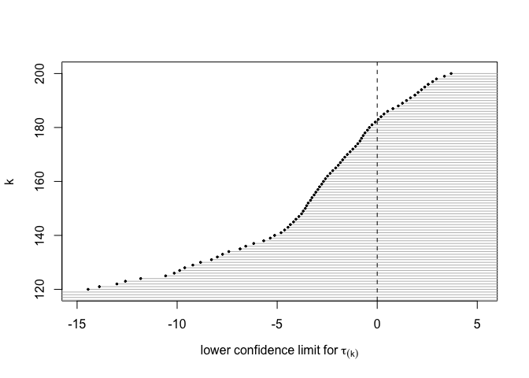

## This is an R package for conducting randomization inference for quantiles of individual treatment effects

### Installation

``` r
devtools::install_github("li-xinran/RIQITE")
```

### load the package

``` r
library(RIQITE)
```

### explanation for the main functions

``` r
?pval_bound # get the p value for testing bounded null

?ci_bound # get the confidence interval for the maximum (or minimum) individual effect

?pval_quantile # get the p value for testing null hypotheses on quantiles of individual effects

?ci_quantile # get the confidence interval for quantiles of individual effects

?calc_power # conduct simulation to compare tests using different Stephenson rank sum statistics

?summary_power_results # summarize the simulation to compare performance of different Stephenson rank sum statistics
```

### A simple example

#### generate the observed data

``` r
n = 200

m = n * 0.5

Z = sample( c( rep(1, m), rep(0, n-m) ) )

Y = rnorm(n) + Z * rnorm(n, mean = 0, sd = 5)
```

#### choose the test statistic

``` r
method.list = list( name = "Stephenson", s = 10 )
```

#### test the null hypothesis that the 95% quantile of individual effect is less than or equal to 0

``` r
pval = pval_quantile(Z, Y, k = ceiling(n*0.95), c = 0, alternative = "greater", method.list = method.list, nperm = 10^4 )
pval
#> [1] 0
```

#### construct simultaneous confidence intervals for all quantiles of individual effects

``` r
ci = ci_quantile( Z = Z, Y = Y, alternative = "two.sided", method.list = method.list, nperm = 10^4,  alpha = 0.05 )
ci
#> CI quantile on 200 units with 100 treated:
#> Method: Stephenson-10
#> Alternative: two.sided with alpha=0.05
#> Quantiles covered from 1 to 200 (200 quantiles)
#> 10000 permutations with tolerance of 0.001
```

#### visualize the simultaneous confidence intervals for all quantiles of individual effects

``` r
ci.limit = ci$lower
plot( NA, ylab="k", xlab=expression("lower"~"confidence"~"limit"~"for" ~tau[(k)]),
      ylim=c( n+1-sum(is.finite(ci.limit)), n ) + c(-1, 1),
      xlim=range( ci.limit[ci.limit>-Inf] ) + c(-0.5, 1.5) )
for(k in 1:length(ci.limit)){
  lines( c( max( ci.limit[k], min(ci.limit[ci.limit>-Inf]) - 100 ), max(ci.limit)+10),
         rep(k,2), col = "grey" )
}
points( ci.limit, c(1:n), pch = 20, cex = 0.5 )
abline(v = 0, lty = 2)
```


