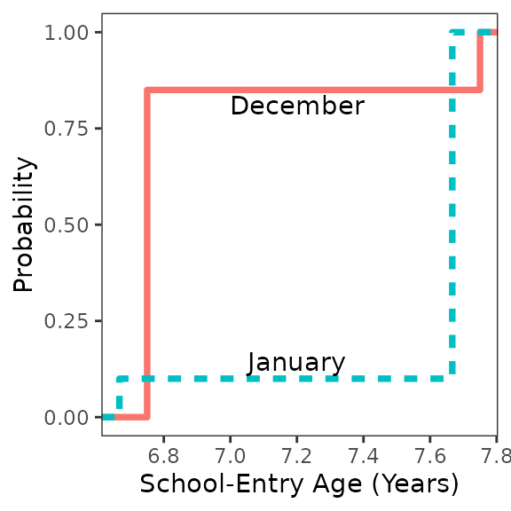
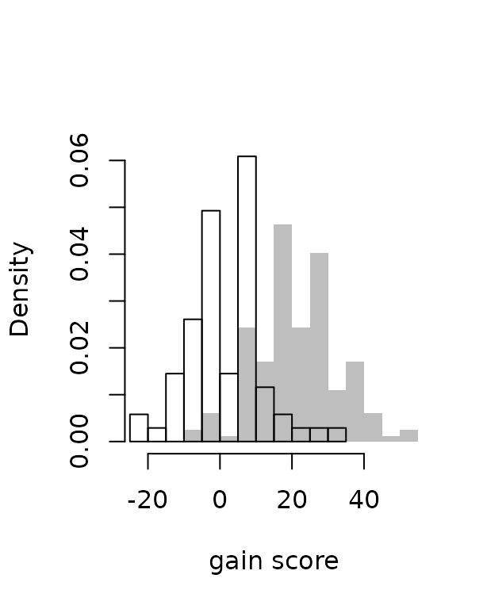
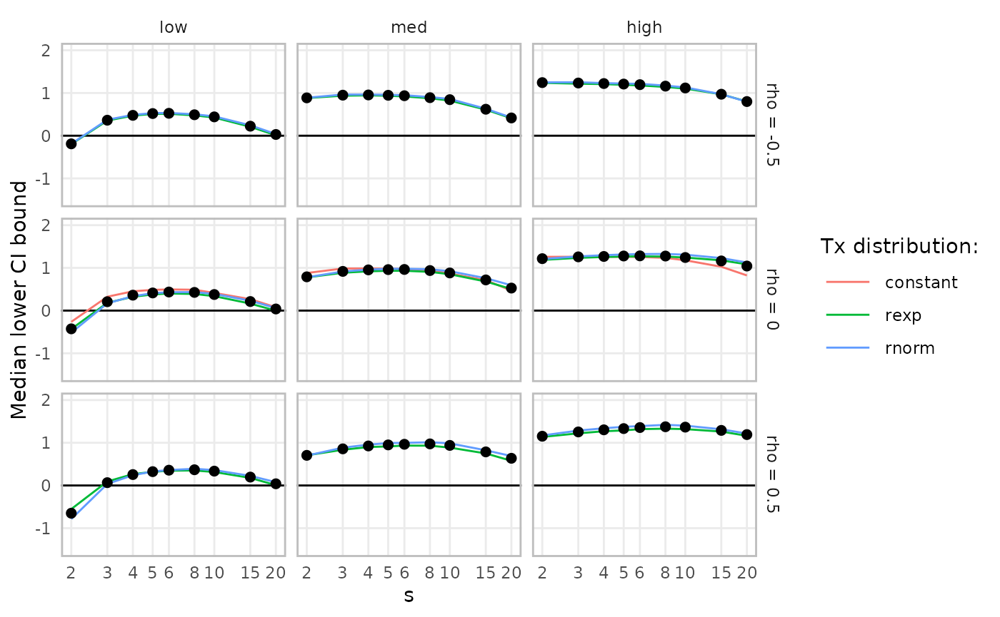
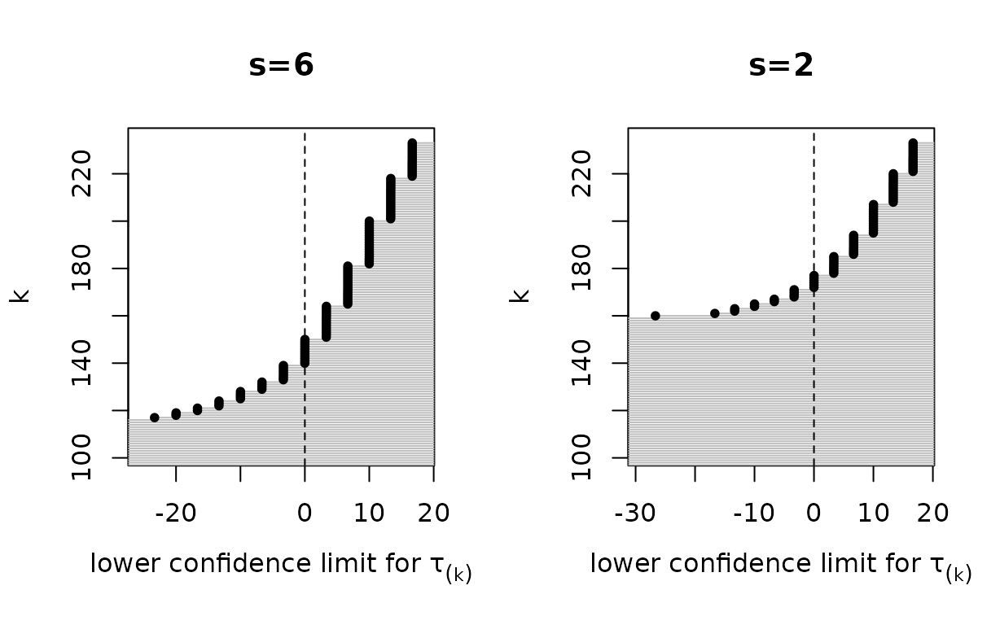

# Data analysis and power analysis using RIQITE

This vignette illustrates using the RIQITE package by implementing the
analyses shown in the main paper of Caughey, Dafoe, Li, and Miratrix.
This is the `demo_code/RIllustration20221028.Rmd` script adapted to
build as a package vignette. A few tweaks are the illustrative
instrumental-variable dataset ships with the package as
`birth_school_age` rather than being hand-rolled inline, and a few
simulation sizes have been reduced so the vignette builds in a
reasonable amount of time (the main paper uses larger permutation and
simulation counts for publication-quality precision).

This vignette does two of the three applications from the main paper.
The main paper also analyzes a homefood nutrition-therapy trial (details
at <https://clinicaltrials.gov/ct2/show/NCT03995303>, data at
<https://doi.org/10.7910/DVN/38X3LX>) the same way as the
professional-development data (example 2). That trial’s raw data is
third-party and not distributed with this package, so it is not
reproduced in this vignette; see `demo_code/RIllustration20221028.Rmd`
in the package source repository for the full analysis, which should run
for anyone who downloads the data from the link above into
`demo_code/data_store/`.

To use RIQITE, first install the package from Github. The github page of
the package (<https://github.com/li-xinran/RIQITE>) contains main
functions with detailed explanation in R documentation, as well as a
simple illustrating example.

Install via `devtools`, and then load:

``` r

devtools::install_github("li-xinran/RIQITE")
library(RIQITE)
```

Next we provide the code used to analyze the data sets in the paper.

## Testing monotonicity of an instrumental variable

We use `birth_school_age`, data constructed to match the summary
statistics reported in Black et al. (2011) – Table 1 cross-tabulates
month of birth and school entry age (early/on-time/late), and Table 3
reports the total number of subjects born in January or December (the
“discontinuity subsample”): 104,023, rounded here to 104,000, split
evenly between the two birth months following Fiorini and Stevens
(2014). See
[`?birth_school_age`](https://li-xinran.github.io/RIQITE/reference/birth_school_age.md)
for details; this is a reconstruction from published aggregate
proportions, not a set of real individual records.

``` r

data(birth_school_age)
dat <- birth_school_age
table(dat$BirthMonth, dat$EntryTiming)
#>      
#>       Early  Late On-Time
#>   Dec     0  7800   44200
#>   Jan  5200     0   46800
```

The following figure shows the empirical distribution functions of the
school-entry age of December-born and January-born subjects. From the
figure, most children started school at an older age if they were born
in January rather than December.

``` r

ggplot(dat, aes(EntryAge, color = BirthMonth, linetype = BirthMonth)) +
  stat_ecdf(geom = "step", show.legend = FALSE, linewidth = 1.3) +
  annotate("text", x = c(7.2, 7.2), y = c(.145, .81),
           label = c("January", "December")) +
  scale_x_continuous(breaks = seq(6, 8, .2)) +
  theme_bw() +
  theme(plot.background = element_blank(),
        panel.grid.major = element_blank(),
        panel.grid.minor = element_blank(),
        plot.title = element_text(hjust = .5)) +
  labs(x = "School-Entry Age (Years)", y = "Probability")
```



We first perform the standard regression analysis assessing the relation
between the instrument (birthday) and the school-entry age.

``` r

lm.fit <- lm(EntryAge ~ (BirthMonth == "Dec"), dat)
cat(paste(
  "estimated average effect is", round(as.numeric(lm.fit$coefficients[2]), digits = 3),
  "and F statistic is", round(as.numeric(summary(lm.fit)$fstatistic[1]), digits = 0),
  "\n"
))
#> estimated average effect is -0.667 and F statistic is 106256
```

This would conventionally be considered persuasive evidence of a valid
instrument. We then perform the randomization test for the bounded null
$`H_{\le 0}`$ on the monotonicity of the instrument: the
difference-in-means statistic, the Wilcoxon rank sum statistic, and the
Stephenson rank sum statistic with parameter $`s = 10`$, along with the
classical Student’s $`t`$-test, producing Table 1 in the paper.

``` r

dat$Z = as.numeric(dat$BirthMonth == "Dec")
dat$Y = dat$EntryAge
n <- length(dat$Z)
m <- sum(dat$Z)
# NOTE: the main paper uses nperm = 10^4; reduced here so the permutation
# matrix (n x nperm) stays small enough to build quickly and with modest
# memory in a vignette.
nperm <- 10^3

Z.perm <- assign_CRE(n, m, nperm)

# difference-in-means
pval.dim <- pval_bound(Z = dat$Z, Y = dat$Y, c = 0, method.list = list(name = "DIM"),
                        alternative = "greater", Z.perm = Z.perm, impute = "control")
ci.dim <- ci_bound(Z = dat$Z, Y = dat$Y, alternative = "greater", method.list = list(name = "DIM"),
                    Z.perm = Z.perm, impute = "control", alpha = 0.10)

# Wilcoxon rank sum (Stephenson with s = 2)
pval.wilc <- pval_quantile(Z = dat$Z, Y = dat$Y, k = n, c = 0, alternative = "greater",
                            method.list = list(name = "Stephenson", s = 2), Z.perm = Z.perm)
ci.wilc <- ci_quantile(Z = dat$Z, Y = dat$Y, k.vec = n, alternative = "greater",
                        method.list = list(name = "Stephenson", s = 2), Z.perm = Z.perm, alpha = 0.10)

# Stephenson rank sum, s = 10
pval.steph10 <- pval_quantile(Z = dat$Z, Y = dat$Y, k = n, c = 0, alternative = "greater",
                               method.list = list(name = "Stephenson", s = 10), Z.perm = Z.perm)
ci.steph10 <- ci_quantile(Z = dat$Z, Y = dat$Y, k.vec = n, alternative = "greater",
                           method.list = list(name = "Stephenson", s = 10), Z.perm = Z.perm, alpha = 0.10)

# classical Student's t-test
ttest = t.test(dat$Y[dat$Z == 1], dat$Y[dat$Z == 0], alternative = "greater")
pval.ttest = ttest$p.value
ci.ttest = round(ttest$conf.int[1], digits = 3)

result = data.frame(test = c("diff-in-means", "Wilcoxon", "Stephenson 10", "t test"),
                     pval = c(pval.dim, pval.wilc, pval.steph10, pval.ttest),
                     lower = c(ci.dim, ci.wilc$lower, ci.steph10$lower, ci.ttest))
knitr::kable(result)
```

| test          | pval |  lower |
|:--------------|-----:|-------:|
| diff-in-means |    1 | -0.669 |
| Wilcoxon      |    1 | -0.916 |
| Stephenson 10 |    0 |  0.084 |
| t test        |    1 | -0.670 |

Finally, we infer the effect range. The range of the effect of birth
month on school-entry age is at least a year, indicating significant
individual effect heterogeneity.

``` r

tau.max.lower = ci_quantile(Z = dat$Z, Y = dat$Y, k.vec = n, alternative = "greater",
                             method.list = list(name = "Stephenson", s = 10), Z.perm = Z.perm, alpha = 0.05)$lower
tau.min.upper = ci_quantile(Z = dat$Z, Y = dat$Y, k.vec = 1, alternative = "less",
                             method.list = list(name = "Stephenson", s = 10), Z.perm = Z.perm, alpha = 0.05)$upper
print(paste("lower confidence limit for effect range is",
            max(0, tau.max.lower - tau.min.upper)))
#> [1] "lower confidence limit for effect range is 1.001"
```

## Evaluating the effectiveness of professional development

We next evaluate a teacher professional development RCT where treated
teachers were given a professional development course on electric
circuits, from Heller et al. (2012). The cleaned data ships with the
package.

``` r

data(electric_teachers)

mod <- lm(gain ~ TxAny, data = electric_teachers)
est_ATE <- round(mod$coefficients[2], digits = 2)
est_ATE
#> TxAny 
#> 19.77
```

``` r

hist(electric_teachers$gain[electric_teachers$TxAny == 1],
     xlim = range(electric_teachers$gain), freq = FALSE, ylim = c(0, 0.065),
     col = "grey", border = FALSE, breaks = 20,
     main = NULL, xlab = "gain score")
hist(electric_teachers$gain[electric_teachers$TxAny == 0],
     freq = FALSE, add = TRUE, breaks = 20, col = NULL)
```



We standardize gain by the control-side variation in outcome at
baseline, to compare treatment and control variation in effect size
units:

``` r

sd_0 = sd(electric_teachers$Per.1[electric_teachers$TxAny == 0])
electric_teachers$std_gain = electric_teachers$gain / sd_0
electric_teachers %>% group_by(TxAny) %>%
  summarise(raw_mean = mean(gain),
            mean = mean(std_gain),
            var = var(std_gain),
            max = max(std_gain),
            min = min(std_gain),
            raw_sd = sd(gain),
            sd = sd(std_gain))
#> # A tibble: 2 × 8
#>   TxAny raw_mean  mean   var   max    min raw_sd    sd
#>   <dbl>    <dbl> <dbl> <dbl> <dbl>  <dbl>  <dbl> <dbl>
#> 1     0     2.46 0.189 0.650  2.55 -1.79    10.5 0.806
#> 2     1    22.2  1.70  0.726  4.08 -0.510   11.1 0.852
```

If there were no correlation between $`Y_i(0)`$ and $`\tau_i`$, the
standard deviation of the treatment impacts would be, using
$`var(Y_i(1)) = var(Y_i(0)) + var(\tau_i)`$, around $`0.28\sigma`$ in
effect size units (the group standard deviations above are approximately
0.852 and 0.806):

``` r

tx_het <- sqrt(0.852^2 - 0.806^2)
tx_het
#> [1] 0.2761666
```

### Determining an s-value for the test statistic

We plan on using a Stephenson’s Rank Sum test, but need to determine an
appropriate value of $`s`$. We first conduct a sensitivity analysis
across a range of scenarios to determine which $`s`$ have the highest
amount of power for the top 10 quantiles, the next 20 quantiles, and the
next 40 quantiles.

To illustrate this process, we first run a check on what the best $`s`$
is for a single scenario, using the empirical distribution of control
outcomes and a normally-distributed, uncorrelated treatment effect (in
standardized units).

``` r

set.seed(303020)
cdat = filter(electric_teachers, TxAny == 0)
ate = est_ATE / sd_0
R = 100 # The main paper uses a larger R
nperm = 10^3
s_list = c(2, 3, 4, 5, 6, 8, 10, 15, 20)
res <- explore_stephenson_s(s = s_list,
                             n = nrow(electric_teachers),
                             Y0_distribution = cdat$std_gain,
                             tx_function = "rnorm", ATE = ate,
                             tx_scale = tx_het, rho = 0,
                             nperm = nperm,
                             R = R, calc_ICC = FALSE,
                             targeted_power = FALSE, k.vec = (233 - 99):233)
```

We get one row per targeted quantile and explored $`s`$, telling us how
easy it was to detect effects at that quantile. Here is our performance
on the 170th largest effect (of 233 effects):

``` r

filter(res, k == 170)
#> # A tibble: 9 × 6
#> # Groups:   s [9]
#>       s     k power SEpower      q_ci     n
#>   <dbl> <dbl> <dbl>   <dbl>     <dbl> <dbl>
#> 1     2   170  0     0      -Inf       40.4
#> 2     3   170  0     0        -1.23    51.0
#> 3     4   170  0.02  0.0133   -0.357   56.9
#> 4     5   170  0.19  0.0605   -0.158   59.6
#> 5     6   170  0.48  0.0904   -0.0350  62.2
#> 6     8   170  0.46  0.101    -0.0219  62.7
#> 7    10   170  0.43  0.0989   -0.0961  60.7
#> 8    15   170  0.17  0.0517   -0.246   53.2
#> 9    20   170  0.07  0.0396   -0.418   43.0
```

We next make a grid of different scenarios to explore to see if our
trends of best $`s`$ are consistent across different possible scenarios.
This is the same grid of scenarios used in the paper; the simulation
results are shipped alongside this vignette
(`heller_s_check_results.rds`) so the vignette does not need to re-run
the full multi-scenario simulation (which is considerably more expensive
than the single-scenario check above) every time it is built.

``` r

checks = expand_grid(TxVar = c(0.25, 0.75),
                      tx_dist = c("rexp", "rnorm"),
                      rho = c(-0.5, 0, 0.5))
# There is no treatment variation, nor correlation with Y0, when
# the tx impact is a constant.
checks = bind_rows(checks,
                    tibble(TxVar = 0, tx_dist = "constant", rho = 0))
```

We aggregate our findings and see what $`s`$ provides the tightest
confidence intervals across a range of quantile groups: the top 10, next
20, next 30, and next 40. For each group, we take the median of the
median lower confidence bound. High points on the curve below indicate
those $`s`$ that are more informative:

``` r

n_units = nrow(electric_teachers)
s_selector = mutate(s_selector,
                     group = cut(k,
                                 breaks = c(0, 233 - 60, 233 - 30, 233 - 10, 233),
                                 labels = c("v low", "low", "med", "high")))

s_selector$rho.f = factor(s_selector$rho,
                           levels = c(-0.5, 0, 0.5),
                           labels = c("rho = -0.5", "rho = 0", "rho = 0.5"))

avg = s_selector %>%
  group_by(s, group, rho, rho.f) %>%
  summarise(q_ci = median(q_ci), n = n(), .groups = "drop") %>%
  filter(group != "v low")

s_agg = s_selector %>%
  group_by(s, group, rho, rho.f, tx_dist) %>%
  summarise(q_ci = median(q_ci), .groups = "drop")

s_agg %>%
  filter(group != "v low") %>%
  ggplot(aes(s, q_ci)) +
  facet_grid(rho.f ~ group) +
  geom_hline(yintercept = 0) +
  geom_line(aes(col = tx_dist), linewidth = 0.5) +
  labs(x = "s", y = "Median lower CI bound", col = "Tx distribution:") +
  scale_x_log10(breaks = unique(s_selector$s)) +
  theme_minimal() +
  theme(panel.grid.minor = element_blank()) +
  geom_point(data = avg, col = "black", size = 2) +
  coord_cartesian(ylim = c(-1.5, 2)) +
  theme(legend.key.width = unit(1, "cm"),
        panel.border = element_rect(colour = "grey", fill = NA, linewidth = 1))
```



We can also tally up the winning $`s`$ across each of the 100 quantiles
we are exploring:

``` r

qis <- s_selector %>%
  group_by(TxVar, tx_dist, rho, group, k) %>%
  filter(q_ci == max(q_ci))
table(group = qis$group, s = qis$s, rho = qis$rho)
#> , , rho = -0.5
#> 
#>        s
#> group    2  3  4  5  6  8 10 15 20
#>   v low  0  0  0  0  1 39 57 31 32
#>   low    0  0  6 36 66 12  0  0  0
#>   med    1 30 39 10  0  0  0  0  0
#>   high  27 13  0  0  0  0  0  0  0
#> 
#> , , rho = 0
#> 
#>        s
#> group    2  3  4  5  6  8 10 15 20
#>   v low  0  0  0  0  0 43 63 51 43
#>   low    0  0  0 15 66 68  1  0  0
#>   med    0  0 11 48 17 24  0  0  0
#>   high   0  6  5 17  1 13  3  5  0
#> 
#> , , rho = 0.5
#> 
#>        s
#> group    2  3  4  5  6  8 10 15 20
#>   v low  0  0  0  0  0 25 48 48 39
#>   low    0  0  0  0 32 87  1  0  0
#>   med    0  0  0  7 33 40  0  0  0
#>   high   0  0  1  1 12 14  8  3  1
```

Looking across our results, a wide range of $`s`$ could be argued for;
small $`s`$ costs us on the lower quantiles, and very large $`s`$ costs
us across the simulations. We adjust our $`s`$ to try and optimize
multiple goals at once, using, e.g., $`s = 6`$.

### Analyzing the teacher professional development data

With our selected $`s = 6`$ in hand, we first test the bounded null
hypothesis that all individual effects are non-positive.

``` r

selected_s = 6
nperm = 10^6
n_units = nrow(electric_teachers)
pval.steph <- pval_quantile(Z = electric_teachers$TxAny, Y = electric_teachers$gain,
                             k = n_units, c = 0, alternative = "greater",
                             method.list = list(name = "Stephenson", s = selected_s), nperm = nperm)
pval.steph
#> [1] 0
```

We then conduct inference for all quantiles of individual treatment
effects, using Stephenson rank statistics with $`s =`$ 6 and $`s = 2`$
(i.e., Wilcoxon rank).

``` r

ci6 = ci_quantile(Z = electric_teachers$TxAny, Y = electric_teachers$gain, alternative = "greater",
                   method.list = list(name = "Stephenson", s = selected_s), nperm = nperm, alpha = 0.10)
ci6
#> CI quantile on 233 units with 164 treated:
#> Method: Stephenson-6
#> Alternative: greater with alpha=0.1
#> Quantiles covered from 1 to 233 (233 quantiles)
#> 1e+06 permutations with tolerance of 0.001
```

``` r

summary(ci6, c = c(-0.0001, 0, 6), k = c(140, 141, 145, 146, 164, 165, 233))
#> CI quantile on 233 units with 164 treated:
#> Method: Stephenson-6
#> Alternative: greater with alpha=0.1
#> Quantiles covered from 1 to 233 (233 quantiles)
#> 1e+06 permutations with tolerance of 0.001
#> 
#> Quantile 117 and above (50%, or 117 units) have finite lower CIs
#> Finite bounds range from -23.33 to 16.67
#> CI for maximal effect is 16.67 and above.
#> 
#> 93 or more units (40%) with effects larger than -1e-04
#> ..quantile 141 and above have lower CI bounds > -1e-04
#> 88 or more units (38%) with effects larger than 0
#> ..quantile 146 and above have lower CI bounds > 0
#> 69 or more units (30%) with effects larger than 6
#> ..quantile 165 and above have lower CI bounds > 6
#> 
#> 
#> Table: Selected quantile confidence intervals
#> 
#>    k    lower   upper
#> ----  -------  ------
#>  140   -0.009     Inf
#>  141    0.000     Inf
#>  145    0.000     Inf
#>  146    0.001     Inf
#>  164    3.341     Inf
#>  165    6.660     Inf
#>  233   16.671     Inf
```

Comparing to Wilcoxon:

``` r

ci2 = ci_quantile(Z = electric_teachers$TxAny, Y = electric_teachers$gain, alternative = "greater",
                   method.list = list(name = "Stephenson", s = 2), nperm = nperm, alpha = 0.10)
summary(ci2, c = c(0, 6))
#> CI quantile on 233 units with 164 treated:
#> Method: Stephenson-2
#> Alternative: greater with alpha=0.1
#> Quantiles covered from 1 to 233 (233 quantiles)
#> 1e+06 permutations with tolerance of 0.001
#> 
#> Quantile 160 and above (69%, or 74 units) have finite lower CIs
#> Finite bounds range from -26.67 to 16.67
#> CI for maximal effect is 16.67 and above.
#> 
#> 59 or more units (25%) with effects larger than 0
#> ..quantile 175 and above have lower CI bounds > 0
#> 48 or more units (21%) with effects larger than 6
#> ..quantile 186 and above have lower CI bounds > 6
```

We can also visualize the bounds:

``` r

par(mfrow = c(1, 2))
s_title = glue::glue("s={selected_s}")
plot_quantile_CIs(ci6, k_start = 102, main = s_title)
plot_quantile_CIs(ci2, k_start = 102, main = "s=2")
```



Finally, we infer the effect range by conducting two tests, one for
greater and one for less.

``` r

tau.max.lower = ci_quantile(Z = electric_teachers$TxAny, Y = electric_teachers$gain, k.vec = n_units,
                             alternative = "greater", method.list = list(name = "Stephenson", s = selected_s),
                             nperm = nperm, alpha = 0.05)$lower
tau.min.upper = ci_quantile(Z = electric_teachers$TxAny, Y = electric_teachers$gain, k.vec = 1,
                             alternative = "less", method.list = list(name = "Stephenson", s = selected_s),
                             nperm = nperm, alpha = 0.05)$upper
max(0, tau.max.lower - tau.min.upper)
#> [1] 0
```

In this case, we have no evidence of effect heterogeneity (all the
effects could be the same).
